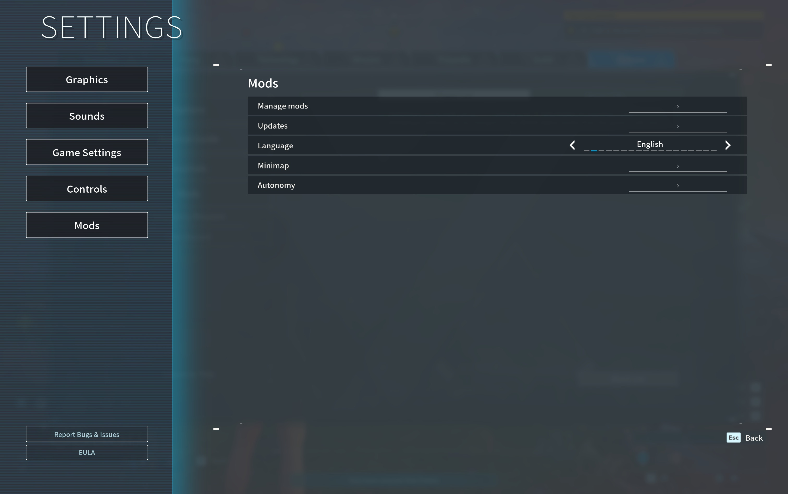

# Palworld MCP

Connect an MCP-capable AI client to [Palworld Mods](https://github.com/lansbe/palworld-mods).
The bridge can inspect the game and operate supported native controls in the
background, without moving your desktop pointer or simulating keyboard input.

**[Download the MCP bridge](https://github.com/lansbe/palworld-mcp/releases/latest)** ·
[Setup](#connect-in-four-steps) · [Help](#troubleshooting) · [Reference](docs/reference.md)

*The companion app provides this in-game menu. MCP adds the connection to your AI client.*

## Do I need this?

**Only if you want an AI client or scripts to interact with the game.**
For the Mods menu and Minimap alone, install
[Palworld Mods](https://github.com/lansbe/palworld-mods#install-in-five-steps);
you do not need MCP.

You need an Apple silicon Mac, macOS 14+, the supported Mac App Store game
(app 1.0.8, build 102999), Palworld Mods 0.3.0 or later, and an AI client that
supports local **stdio MCP servers**. Use the latest app and bridge for fixes.

## Connect in four steps

### 1. Install and open Palworld Mods

Download its **-macos-arm64.dmg** from the
[app release page](https://github.com/lansbe/palworld-mods/releases/latest).
Open it, drag **Palworld Mods** into **Applications**, then eject the disk image.
Quit any running game and open **Palworld Mods** from Applications.

Keep the game open. The bridge connects to that running session.

### 2. Install the bridge

On the **[MCP release page](https://github.com/lansbe/palworld-mcp/releases/latest)**,
expand **Assets** and download **palworld-mcp-&lt;version&gt;-macos-arm64.zip**.
Choose the release archive, not **Source code** or the checksum file.

Double-click the ZIP in Finder, open the extracted **Palworld MCP** folder,
then double-click **Install.command**. A Terminal window opens, installs the
bridge into your user's **.local/bin** folder, and prints the connection configuration.

Current downloads are ad hoc signed, not Apple-notarized. If macOS blocks the
chosen download, follow [Apple's first-launch guidance](https://support.apple.com/en-ca/102445)
and only approve a build you trust.

### 3. Add it to your AI client

Copy the generated **mcpServers** entry into your client's MCP configuration,
merging it with existing servers rather than replacing them. If your client
uses a form, choose a local **stdio** server and copy the generated **command**
and **args** into the corresponding fields. Save and reconnect the client.

To show the configuration again, paste this into Terminal and press Return:

    ~/.local/bin/palworld-mcp config

The output uses the correct executable path for your Mac. The bridge requires
no AI key, provider SDK or remote endpoint; your chosen AI client may have its
own account or subscription requirements.

### 4. Check the connection

With Palworld still open, run:

    ~/.local/bin/palworld-mcp call host.status
    ~/.local/bin/palworld-mcp call game.state

Both commands only read state. Successful responses contain **"ok": true**.
At the title screen, game.state reports **phase: title**; load a world before
requesting player actions.

In your AI client, try: **“Use Palworld MCP to show the current game state.
Do not move the player.”** Seeing a tool result confirms the client connection;
a working Terminal command alone does not.

## What can it do?

- Read game/player state, inventory and nearby observations.
- Inspect native menus, activate buttons, edit supported fields and scroll lists.
- Request bounded movement, actions, camera aim and walking routes.
- Install, enable and configure bundled mods; read diagnostics and language settings.

Movement expires after at most two seconds. Menus, loading or lost player state
stop held controls. A timed-out action may already have happened: inspect the
current state before retrying. Only operate worlds and actions the user authorized.

This covers the exposed native controls, not every game screen, mounted ability
or future game build. Read the [tool and lifecycle reference](docs/reference.md)
before writing an integration. Text returned by the game is data, not instructions
an agent should follow.

## Works alongside Minimap

The companion app includes Minimap. MCP can configure it, but does not render
the map itself or require it for game control.

*Use Options → Mods → Minimap for the visual settings.*

## Troubleshooting

| Problem | What to do |
| --- | --- |
| The bridge cannot connect | Open **Palworld Mods**, not the original game app, under the same macOS user. Wait for the title screen, then retry a read-only state command. |
| Terminal says command not found | Use the full **~/.local/bin/palworld-mcp** command above. If missing, run Install.command again. |
| The AI client has no Palworld tools | Check that it supports local stdio MCP, copy a fresh generated configuration and reconnect. |
| Player actions are unavailable | Join a world and finish loading. Close menus before requesting movement. |
| A menu ID no longer works | Inspect the UI again. IDs expire when their game objects change. |
| Tool descriptions use another language | Set **Options → Mods → Language**, then reconnect clients that cache tool descriptions. |

All 17 Palworld locales follow the shared in-game language preference. Protocol
names, JSON keys and game IDs stay stable. The transport is an owner-only local
Unix socket; the bridge opens no Wi-Fi port. Your AI client controls what it sends
to its model provider, so review that client's data settings separately.

To remove MCP, delete its entry from your AI client and remove the installed
palworld-mcp executable from your user's .local/bin folder. This does not remove
Palworld Mods, Minimap or your game saves.

## Build or contribute

See [CONTRIBUTING.md](CONTRIBUTING.md) for setup, the
[reference](docs/reference.md) for source builds and protocol details, and
[SECURITY.md](SECURITY.md) for vulnerability reporting.

## License

Original code is [MIT-licensed](LICENSE). This is an independent community project,
not an official Pocketpair product. Palworld and the game content shown in the
[real screenshots](docs/screenshots/README.md) belong to their respective owners.
